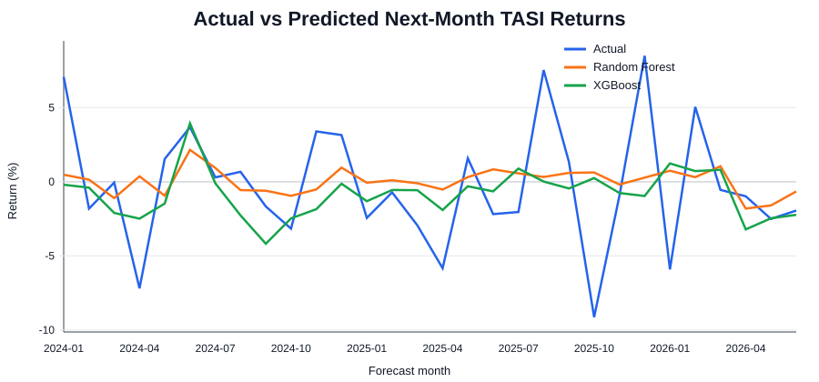
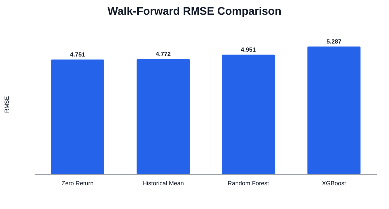
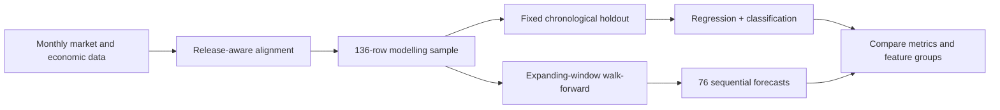
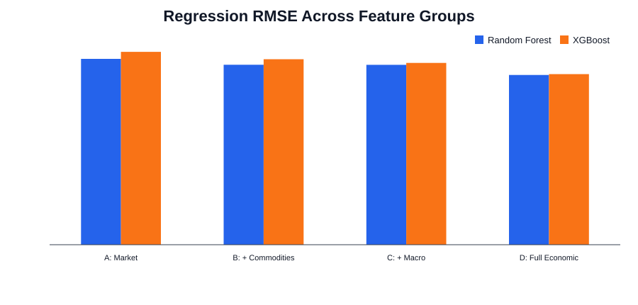
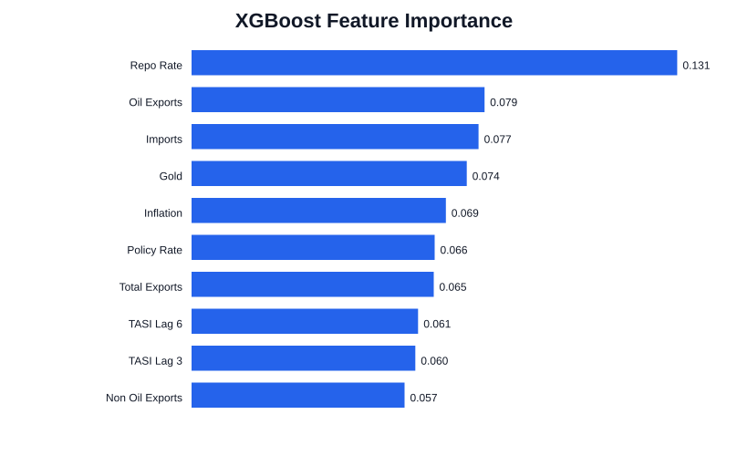

# Saudi TASI Return Forecasting with Release-Aware Economic Data


A time-series forecasting project testing whether **Saudi macro-financial, commodity and trade indicators add predictive value beyond market history** when forecasting next-month Tadawul All Share Index (TASI) returns.

The project uses chronological validation, release-aware feature alignment, simple benchmarks and expanding-window walk-forward testing rather than a random train/test split.

> **Headline finding:** Random Forest and XGBoost showed modest gains in the recent fixed holdout, but those gains did **not** survive the longer sequential walk-forward evaluation. Simple benchmarks remained highly competitive.

<p align="center">
  
</p>

## 30-second recruiter summary

**Problem:** Can broader economic information improve one-month-ahead TASI return forecasts beyond historical market behaviour?

**Approach:** Built a release-aware monthly forecasting pipeline using 16 predictors across four nested information sets. Compared Zero-Return and Historical-Mean benchmarks, AutoReg(12), Random Forest and XGBoost using a fixed chronological holdout and 76 expanding-window walk-forward forecasts.

**Result:** XGBoost achieved the lowest fixed-test MAE (**3.049**), while Random Forest achieved the lowest fixed-test RMSE (**4.044**) and highest regression directional accuracy (**63.33%**). In the longer walk-forward evaluation, the Historical-Mean benchmark had the lowest MAE (**3.879**) and the Zero-Return benchmark had the lowest RMSE (**4.751**).

**What this demonstrates:** time-series validation, leakage-aware feature engineering, benchmark discipline, model comparison, reproducible analysis and cautious interpretation of ML results.

---

## Key results

### Fixed chronological holdout: Jan 2024–Jun 2026

| Model | MAE ↓ | RMSE ↓ | R² ↑ | Directional accuracy ↑ |
|---|---:|---:|---:|---:|
| Zero Return | 3.194 | 4.096 | -0.005 | 60.00% |
| Historical Mean | 3.291 | 4.148 | -0.030 | 40.00% |
| AutoReg(12) | 3.344 | 4.181 | -0.047 | 43.33% |
| **Random Forest** | 3.112 | **4.044** | **0.021** | **63.33%** |
| **XGBoost** | **3.049** | 4.063 | 0.011 | 56.67% |

### Expanding-window walk-forward: Mar 2020–Jun 2026

| Model | MAE ↓ | RMSE ↓ | R² ↑ | Directional accuracy |
|---|---:|---:|---:|---:|
| Zero Return | 3.886 | **4.751** | -0.026 | — |
| **Historical Mean** | **3.879** | 4.772 | -0.035 | — |
| Random Forest | 4.022 | 4.951 | -0.114 | **56.58%** |
| XGBoost | 4.213 | 5.287 | -0.270 | 52.63% |

<p align="center">
  
</p>

The longer sequential evaluation changes the interpretation: **the recent machine-learning advantage is not temporally robust**.

---

## Why this project is stronger than a standard “fit a model” portfolio project

- **Chronological evaluation:** no random train/test split for time-series data.
- **Release-aware predictors:** macroeconomic and trade variables are shifted to approximate when they could have been known.
- **Strong baselines:** ML models must beat Zero-Return, Historical-Mean and AutoReg(12), not just each other.
- **Nested information sets:** tests whether commodities, macro variables and trade data actually improve forecasts.
- **Two forecasting tasks:** return magnitude and positive/non-positive direction.
- **Walk-forward robustness:** 76 sequential forecasts test whether a result survives changing market conditions.
- **Reproducibility checks:** the code asserts sample size, date ranges and headline metrics.
- **Transparent limitations:** missing source metadata is documented rather than guessed.

---

## Data design

The final release-aware specification contains **136 complete monthly observations from March 2015 to June 2026** and **16 predictors**.

| Information set | Predictors | Availability treatment |
|---|---|---|
| Market history | TASI lags 1, 3, 6, 12; rolling 3M and 6M return SD | Historical by construction |
| Commodities | Brent, Gold | Lagged 1 month |
| Macro / monetary | Inflation YoY, Policy Rate, Repo Rate | Inflation lagged 1 month; rates current at month end |
| Saudi trade | Trade Balance, Total Exports, Non-Oil Exports, Oil Exports, Imports | Lagged 2 months |



See [`docs/DATA_DICTIONARY.md`](docs/DATA_DICTIONARY.md) for the feature definitions.

---

## Nested feature groups

- **A — Market Only:** 6 predictors
- **B — + Commodities:** 8 predictors
- **C — + Macro / Monetary:** 11 predictors
- **D — Full Economic:** 16 predictors

<p align="center">
  
</p>

The Full Economic specification produced the strongest fixed-test regression results for both tree models. This is treated as **period-specific evidence**, not a universal rule that adding predictors improves forecasts.

## Model interpretation

<p align="center">
  
</p>

The fitted XGBoost model placed the highest importance on **Repo Rate**, followed by **Oil Exports, Imports and Gold**. Feature importance describes how the fitted model used the predictors; it is **not evidence of causality**.

---

## Repository structure

```text
saudi-tasi-forecasting/
├── README.md
├── PROJECT_SUMMARY.md
├── requirements.txt
├── data/
│   ├── README.md
│   └── final/
├── src/
│   └── run_analysis.py
├── results/
├── figures/
├── docs/
├── tests/
└── .github/workflows/tests.yml
```

## Reproduce the analysis

```bash
git clone https://github.com/Ahasuper786/saudi-tasi-forecasting.git
cd saudi-tasi-forecasting
python -m venv .venv
# Windows: .venv\Scripts\activate
# macOS/Linux: source .venv/bin/activate
pip install -r requirements.txt
python src/run_analysis.py
```

Run the checks with:

```bash
pip install -r requirements-dev.txt
pytest -q
```

The public repository contains the final release-aware modelling table needed by the analysis. Raw source archives are intentionally not published here because the archived TASI file does not preserve verifiable provider metadata and redistribution rights were not established.

---

## Limitations

- The monthly sample is small for machine-learning forecasting.
- Monthly aggregation can hide higher-frequency relationships.
- The predictor set omits potentially relevant information such as global equity indices, news and sentiment.
- The archived TASI raw file does **not** preserve metadata identifying its original provider.
- Feature importance is predictive, not causal.
- No model demonstrated stable superiority across both evaluation designs.

## Skills demonstrated

`Time-series forecasting` · `Feature engineering` · `Data leakage prevention` · `Walk-forward validation` · `Random Forest` · `XGBoost` · `AutoReg` · `Logistic regression` · `Model evaluation` · `Feature importance` · `pandas` · `scikit-learn` · `statsmodels` · `Reproducible analysis`

For the concise case-study narrative, see [`docs/CASE_STUDY.md`](docs/CASE_STUDY.md).
